# Harsh Dwivedi

### Java Developer | Spring Boot Engineer | GenAI Enthusiast

Building intelligent applications. Engineering reliable backends. Exploring what's next.

---

## About Me

I'm Harsh, a developer from India passionate about software engineering, backend development, and emerging AI technologies.

My primary focus is Java and the Spring ecosystem. I enjoy developing backend applications, designing REST APIs, integrating databases, and exploring scalable application architectures.

I'm also exploring Generative AI, Large Language Models, and Retrieval-Augmented Generation to bring intelligent capabilities into real-world software applications.

- Developing backend applications with Java and Spring Boot.
- Exploring Spring AI, LLMs, RAG, LangChain and Ollama.
- Interested in secure application development and authentication.
- Working with relational and NoSQL databases.
- Practicing Data Structures and Algorithms.
- Interested in scalable and intelligent applications.
- Open to collaboration on Java, Backend and AI-related projects.

> My philosophy: Write clean code, understand the fundamentals, build consistently, and never stop learning.

---

## Developer Focus

| Area | Technologies and Interests |
|---|---|
| Backend Engineering | Java, Spring Boot, Spring Security |
| Artificial Intelligence | Spring AI, LLMs, RAG, LangChain |
| API Engineering | REST APIs, JWT, Swagger |
| Database Engineering | MySQL, PostgreSQL, MongoDB, Redis |
| Distributed Systems | Apache Kafka, RabbitMQ |
| Frontend Development | HTML, CSS, JavaScript, React |
| Cloud and DevOps | AWS, Docker, Kubernetes, CI/CD |

---

## Technical Skills

### Programming Languages

### Java and Backend Engineering

### Generative AI and Data Science

### Databases and Storage

### Cloud, DevOps and Deployment

### Frontend and UI/UX Development

### Developer Tools and Creative Software

---

## What I Build

I enjoy developing applications that combine backend engineering, database management, APIs and intelligent technologies.

| Development Area | My Interests |
|---|---|
| Backend Applications | Java, Spring Boot, Spring Security |
| AI-Powered Applications | Spring AI, LLMs, RAG, Ollama |
| API Development | REST APIs, JWT, Swagger |
| Database Systems | SQL, NoSQL, ORM, Redis |
| Distributed Systems | Kafka, RabbitMQ |
| Web Applications | HTML, CSS, JavaScript, React |

### Development Interests

- AI-powered applications using Java and Spring AI.
- Hospital and College Management Systems.
- Secure backend applications using Spring Security and JWT.
- Database-driven applications using Spring Data JPA and Hibernate.
- Intelligent applications using LLMs and RAG.

---

## GitHub Performance

<picture>
  <source media="(prefers-color-scheme: dark)" srcset="./assets/cards.dark.svg"/>
  <source media="(prefers-color-scheme: light)" srcset="./assets/cards.light.svg"/>
  
</picture>

---

## Currently Exploring

| Technology | Learning Direction |
|---|---|
| Spring AI | Building AI-powered Java applications |
| Large Language Models | Understanding LLM integration |
| RAG | Context-aware AI applications |
| LangChain | LLM application workflows |
| Docker | Containerization and deployment |
| Kafka | Event-driven architectures |
| Data Structures and Algorithms | Problem-solving and optimization |

---

## Let's Connect

I'm always interested in connecting with developers, exchanging ideas, exploring new technologies, and collaborating on meaningful projects.

 

### Code. Learn. Build. Repeat.

Thanks for visiting my profile. Let's connect, collaborate and create something extraordinary.

